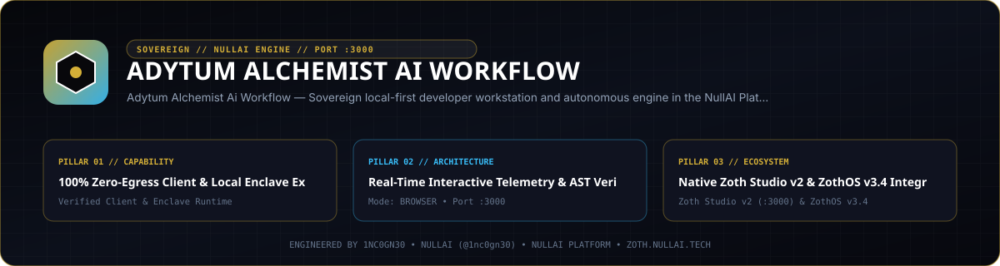

<div align="center">
  
</div>

<br />

# ⚡ Adytum Alchemist AI Workflow (`adytum`)

<p align="center">
  <strong>22-Key Hermetic Ageless Wisdom Planning Rite, Deterministic Invariant Gatekeeper &amp; Model Context Protocol (MCP) Server</strong>
</p>

<p align="center">
  
  
  
  
  <a href="https://buy.stripe.com/3cIfZg27PdKo2D64Ocfw40X"></a>
</p>

---

## 🌟 What It Does & How It Works

**Adytum Alchemist AI Workflow** (`adytum` / `adytum-alchemist-ai-workflow`) is an architectural planning discipline, local gatekeeper CLI, interactive web workstation (`:8135`), and autonomous agent MCP server based on the **22 Major Keys of Ageless Wisdom** (Builders of the Adytum / BOTA lineage).

Instead of ad-hoc prompt guessing or unverified coding agent loops, Adytum guides engineers and AI agents through a **three-stage planning rite** across all 22 Keys (`Key 0: The Fool` through `Key 21: The World`):

1. **Conscious Intention & Symbol Observation**:
   - Inspect the canonical Tarot Key (`0–21`), its Hebrew letter, Gematria value, Astrological attribution, and **AI Chemistry Lesson**.
   - Formulate a concrete **Conscious Intention**, **Symbol Observation**, and **Subconscious Seed Directive**.
2. **5-Minute Subconscious Incubation Gate**:
   - Hold the seed directive during a timed 5-minute meditation while observing the canonical BOTA archetype (with an optional fast-forward control for rapid iteration).
   - Record the **Post-Meditation Architectural Synthesis** to unlock the next Gate (`[GATE OPENED]`).
3. **22-Point Deterministic Invariant Gatekeeper**:
   - Before writing code or dispatching subagents, pass your PRD, specification, or architectural plan through the **15-Rule / 22-Key Hermetic Invariant Gatekeeper** (`adytum validate <file>` or the in-app **🛡️ 22-Key Plan Gatekeeper** drawer).
   - Audits specifications for single-pointed scope, state/memory integrity, standardized JSON/type schemas, explicit boundary tradeoffs, air-gapped isolation (`127.0.0.1`), error resilience, deterministic verification tests, latency budgets, resource cleanup, anti-deception (zero mock/placeholder state), structured logging, and CI release gates.

---

## 🏛️ The 22 Canonical Hermetic Keys & Engineering Invariants

| Key | Arcana | Hebrew Letter | Gematria | Astrology | Engineering Invariant |
| :--- | :--- | :--- | :--- | :--- | :--- |
| **0** | **The Fool** | Aleph | 1 | Air | Pure Potentiality & Unbounded Ideation |
| **1** | **The Magician** | Beth | 2 | Mercury | Focused Intention & Single-Pointed Execution |
| **2** | **The High Priestess** | Gimel | 3 | Moon | Cryptographic Memory & Zero-Leak Storage |
| **3** | **The Empress** | Daleth | 4 | Venus | Generative Architecture & Organic Scalability |
| **4** | **The Emperor** | Heh | 5 | Aries | Immutable Invariants & Structural Governance |
| **5** | **The Hierophant** | Vav | 6 | Taurus | Standardized Contracts & Semantic Schemas |
| **6** | **The Lovers** | Zain | 7 | Gemini | Binary Tradeoff Discipline & Clean Boundaries |
| **7** | **The Chariot** | Cheth | 8 | Cancer | Air-Gapped Isolation & Sandbox Enclosures |
| **8** | **Strength** | Teth | 9 | Leo | Graceful Error Handling & Self-Healing Loops |
| **9** | **The Hermit** | Yod | 10 | Virgo | Deterministic Verification & Zero-Dependency Audits |
| **10** | **Wheel of Fortune** | Kaph | 20 | Jupiter | State Loop Determinism & Replayability |
| **11** | **Justice** | Lamed | 30 | Libra | Strict Verification Tests & Equilibrated Budgets |
| **12** | **The Hanged Man** | Mem | 40 | Water | Asynchronous Non-Blocking Flow & Calm Pacing |
| **13** | **Death** | Nun | 50 | Scorpio | Ruthless Cruft Pruning & Resource Cleanup |
| **14** | **Temperance** | Samekh | 60 | Sagittarius | Rate-Limiting & High-Concurrence Harmony |
| **15** | **The Devil** | Ayin | 70 | Capricorn | Anti-Deception Audit & Elimination of Mock State |
| **16** | **The Tower** | Peh | 80 | Mars | Chaos Resilience & Graceful Crash Recovery |
| **17** | **The Star** | Tzaddi | 90 | Aquarius | Transparent Telemetry & Clear Logging |
| **18** | **The Moon** | Qoph | 100 | Pisces | Deep Synaptic Retention & Subconscious Caches |
| **19** | **The Sun** | Resh | 200 | Sun | Production-Grade Elegance & High-Fidelity UI |
| **20** | **Judgement** | Shin | 300 | Fire | Comprehensive Integration Sentinel & Release Gate |
| **21** | **The World** | Tav | 400 | Saturn | Hermetic Sovereign Wholeness & Zero-Egress Proof |

---

## 💻 ZothOS CLI Usage (`adytum` & `adytum-alchemist-ai-workflow`)

Both `adytum` and `adytum-alchemist-ai-workflow` are installed globally in `/usr/local/bin` on ZothOS:

```bash
# List all 22 Ageless Wisdom Keys and their engineering invariants
adytum list

# Output full canonical keys in machine-readable JSON
adytum list --json

# Inspect a specific Key (0 to 21) with Hebrew letter, gematria, and symbolism
adytum key 0
adytum key 7 --json

# Generate a 22-point deterministic quality checklist for your project
adytum invariants "SovereignAuthEnclave"
adytum invariants "SovereignAuthEnclave" --json

# Audit a plan or PRD against the 22 hermetic quality invariants
adytum validate ./plan.md
cat architectural_spec.md | adytum validate - --json

# Auto-harden a draft specification so all 15 Hermetic Invariants pass (100/100 A+)
adytum harden ./plan.md
adytum harden ./plan.md --json

# Launch the local Web Workstation on http://127.0.0.1:8135
adytum web

# Start the Model Context Protocol (MCP) server over stdio
adytum mcp
```

---

## 🌐 3-Column Sovereign Web Workstation (`:8135` & Zoth Studio v2)

- **Local ZothOS Workstation**: `http://127.0.0.1:8135` (served by `server/serve.js` or `adytum web`)
- **REST API Endpoints (`:8135`)**:
  - `GET /health` — Service health & zero-egress status
  - `GET /api/keys` & `GET /api/keys/:id` — All 22 canonical BOTA Keys, Hebrew letters, Gematria, and symbolism
  - `GET /api/invariants?project=MyApp` — Generate a 22-point deterministic invariant checklist
  - `POST /api/validate` — Audit a specification (`{"plan": "..."}`) and return score, grade, and pass/fail checks
  - `POST /api/harden` — Automatically remediate failing invariants to achieve `100/100 (A+)`
- **Zoth Studio v2 God-Mode Workstation**: `https://zoth.nullai.tech/tools/adytum-alchemist-ai-workflow` and `/adytum`

Features included in the 3-Column Web Workstation:
- **Left Column (22-Key Hermetic Arcana Rail)**: Instant 1-click navigation across all 22 Keys (`00 · The Fool` → `21 · The World`) with Hebrew letters, Gematria, and completion status (`✔`).
- **Center Column (Active Tarot Key Initiation & 5-Min BOTA Incubation)**: Displays the canonical BOTA Tarot card artwork (`/tarot/fool.jpg`..`/tarot/world.jpg`), Attribution, Engineering Invariant, AI Chemistry Lesson, 3-step BOTA Practice Protocol (with **⚡ Populate Archetypal Example**), interactive 5-minute meditation chronometer, and Sovereign Local Oracle synthesis.
- **Right Column (Live 22-Key Architectural Plan Gatekeeper & Auto-Hardener)**: Paste any PRD or architecture spec for live 15-rule scoring (`0–100`), click **✨ Auto-Harden Invariants** to remediate missing clauses to `100/100 (A+)`, and export `.md` PRD or `.json` manifest.

---

## 🤖 Model Context Protocol (MCP) Setup

Connect Adytum directly to Claude Desktop, Cursor, Cline, Hermes Agent, or Antigravity:

```json
{
  "mcpServers": {
    "adytum": {
      "command": "adytum",
      "args": ["mcp"],
      "env": {
        "ZOTH_ZERO_EGRESS": "true"
      }
    }
  }
}
```

### Exposed MCP Tools:
- `adytum_list_keys`: List all 22 Hermetic Keys with Hebrew letters and core invariants.
- `adytum_get_key`: Retrieve deep canonical symbolism, gematria, and reflection prompts for any Key (`0–21`).
- `adytum_validate_plan`: Validate a software proposal, PRD, or plan text against the 22 invariants.
- `adytum_generate_invariants`: Generate a 22-point invariant checklist for any project.

---

## 🧪 Automated Verification

```bash
npm test
```

---

## ☕ Support Open-Access Sovereign Tools

All ZothOS and NullAI tools are **100% free, open, and unlocked by default** with zero paywalls.
- **☕ Buy Us a Coffee (Stripe)**: [https://buy.stripe.com/3cIfZg27PdKo2D64Ocfw40X](https://buy.stripe.com/3cIfZg27PdKo2D64Ocfw40X)
- **◎ Solana Tip Address**: `GG2eQbVh8ut1BK6j1A2tz7pSySdLpD38BgyEhGcxdXoK`

---

**Engineered by 1nc0gn30 • NullAI ([@1nc0gn30](https://github.com/1nc0gn30)) • [NullAI Platform](https://nullai.tech)**
